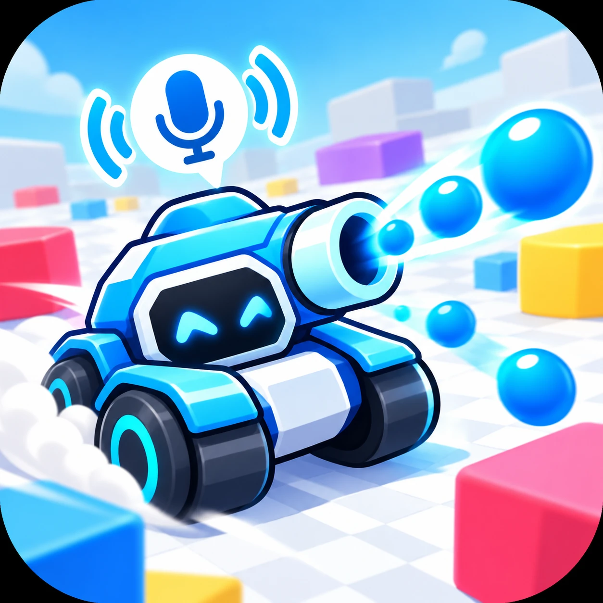
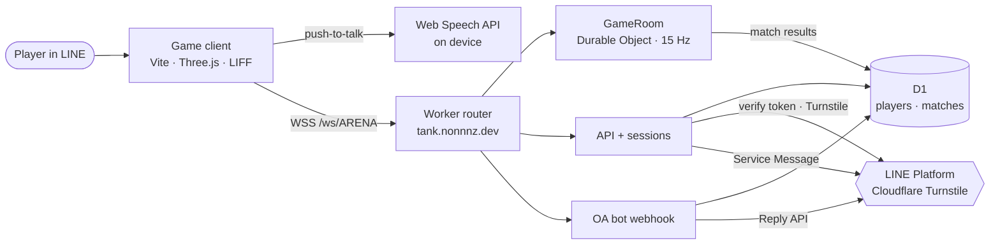

<div align="center">



# Tank Arena 3D

**Shout “FIREBALL!” in a real-time multiplayer tank battle inside LINE.**

[](https://developers.line.biz/en/)
[](https://developers.line.biz/en/docs/line-mini-app/)
[](https://threejs.org/)
[](https://developers.cloudflare.com/durable-objects/)
[](https://www.typescriptlang.org/)

[▶ Play in LINE](https://miniapp.line.me/2012061553-J4ACK3AT) · [Play in browser](https://tank.nonnnz.dev) · [Pitch & architecture](https://tank-pitch.nonnnz.dev) · [LINE OA @394ggngw](https://line.me/R/ti/p/@394ggngw)

</div>

---

## What it is

A bright low-poly 3D arena where up to **12 players** drive tanks, auto-shoot shapes for XP, level up, and fight each other in **3-minute matches**. The ultimate ability is voice-controlled: tap the mic, shout **“FIREBALL!”** (or **ไฟร์บอล**), and a giant fireball blasts every tank near the impact — on everyone's phone at once.

Built for **LINE HACK 2026** — *Create a Multiplayer Game on LINE MINI App*.

| | |
|---|---|
| 🎤 **Voice ultimate** | Browser-native Web Speech API, push-to-talk, English + Thai. No audio ever reaches our server; a Tap button does the same action. |
| ⚔️ **Real multiplayer** | WebSocket → one authoritative Durable Object. 15 Hz server ticks, client interpolation, instant game events. |
| 🛡️ **Cheat-proof** | Clients send only input (move, upgrade, cast). Position, HP, damage, XP, cooldowns and score are computed on the server. |
| 💬 **LINE everywhere** | LIFF login, Share Target Picker invites, OA bot commands, and Service Message match results. |
| 💸 **Runs free** | Workers, Durable Objects (SQLite), D1 and static assets on Cloudflare's free plan, with built-in budget and abuse guards. |

## How to play

1. Open the MINI App in LINE (or the browser link) and choose **Login with LINE** (ranked) or **Play as guest** (random name, Cloudflare Turnstile check).
2. Move with the joystick (WASD on desktop). Your tank aims and fires by itself.
3. Destroy shapes for XP → level up → upgrade **Damage**, **Fire Rate** or **Max HP**.
4. Tap the big mic and shout **FIREBALL!** (20 s cooldown).
5. After the match, tap **Send result to LINE** to get your result as a Service Message.

## LINE integration

| LINE feature | How it's used |
|---|---|
| **LIFF / MINI App** | `liff.init`, login, profile. Room and view survive `liff.state` redirects. |
| **ID token verification** | Raw ID token verified server-side (`/oauth2/v2.1/verify`, `iss`/`aud`/`exp` checked), access-token fallback, then our own HMAC session. |
| **Share Target Picker** | *Invite* sends a Flex card that opens the MINI App permanent link. |
| **Messaging API (OA)** | Webhook with signature check, Reply API only. `/rank` top 10, `/party` and `/create` arena invite, `/me` your stats. Works in groups. |
| **Service Message** | After a match the player taps a button; the server sends their own recorded result via `notifier/token` → `notifier/send` (template `completion_d_en`), once per match. |

## Architecture



Interactive diagrams: [system architecture](https://tank-pitch.nonnnz.dev/architecture) · [FIREBALL sequence](https://tank-pitch.nonnnz.dev/fireball)

## Free-tier & security guards

- **One public arena** (`ARENA`, 12 players). Any other room id is rejected before a Durable Object is created.
- **Daily budget**: the arena counts incoming messages and connections per UTC day and closes politely before Cloudflare's free limits.
- **Flood protection**: clients over 25 messages/s are disconnected; messages over 512 bytes are ignored; input is validated and clamped.
- **Origin allowlist** for WebSockets; **Turnstile** for guests; signed sessions for everyone.
- **Secrets** live only in Worker Secrets — never in the browser bundle or this repo.
- Leaderboard is edge-cached for 30 s.

## Project layout

```
index.html               HUD markup + styles
src/client/              Three.js scene, game loop, voice, LINE/LIFF helpers
src/shared/protocol.ts   Network contract shared by client and server
worker/index.ts          Router: static assets, /ws/ARENA, /api/*, /webhook
worker/room.ts           GameRoom Durable Object (authoritative simulation)
worker/api.ts            Sessions (LINE + guest), leaderboard, config
worker/line-bot.ts       OA webhook + Flex replies
worker/service-message.ts  LINE MINI App Service Message
schema.sql               D1 tables
public/ui/               UI icons
pitch/                   Pitch site (tank-pitch.nonnnz.dev)
```

## Run locally

```bash
npm install
cp .dev.vars.example .dev.vars   # fill in your own values
npx wrangler d1 execute line-tank-arena --local --file schema.sql
npm run build && npx wrangler dev
```

Worker secrets used in production: `MINI_APP_CHANNEL_ID`, `MINI_APP_CHANNEL_SECRET`, `LINE_OA_CHANNEL_ID`, `LINE_OA_CHANNEL_SECRET`, `SESSION_SECRET`, `TURNSTILE_SECRET`. Public vars (`LIFF_ID`, `TURNSTILE_SITE_KEY`, `PUBLIC_URL`) are in `wrangler.jsonc`.

Deploy: `npm run deploy`.

## Team

Built for LINE HACK 2026 by:

| | Member | Role |
|---|---|---|
|  | **[nonnnz](https://github.com/nonnnz)** | Game, multiplayer server, deployment |
|  | **[thanitsakdue](https://github.com/thanitsakdue)** | LINE platform setup: created the LINE Official Account and LINE MINI App channels, and connected LINE login and the OA to the game |

Tanks, arena and effects are procedural Three.js; UI icons are original art for this project.
